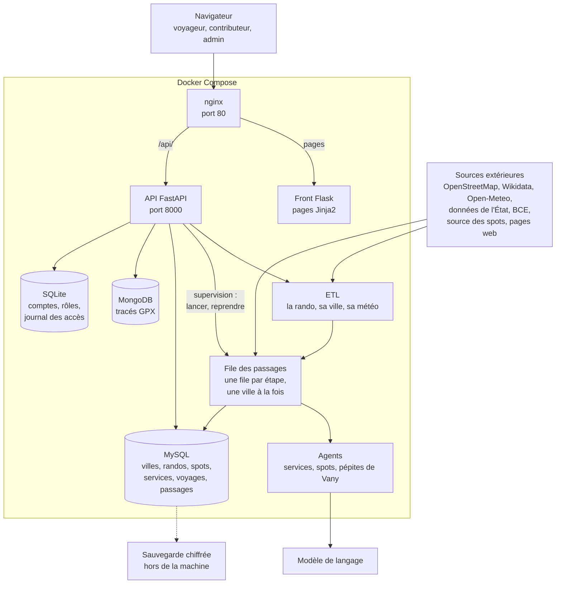

# RandoVango

Application de planification de randonnées en itinérance en van : le voyageur choisit une ville, ses randos, ses spots
pour la nuit et les services utiles autour, et Vany lui propose des pépites pour chaque jour.

## Architecture



- **Une rando envoyée** (page d'ajout, ou dossier d'attente) est lue et chargée tout de suite, avec la météo de sa
  ville. Le reste (OSM et Wikidata, carburants, pharmacies, spots, pépites, services) part dans la
  [file des passages](docs/architecture_agents.md#la-file-des-passages) : chaque étape prend une ville à la fois.
- **Les agents proposent, le code contrôle, l'humain tranche** : chaque appel au modèle est mesuré, son coût est suivi
  en euros sous un budget, et les décisions de la supervision priment sur les agents
  ([architecture des agents](docs/architecture_agents.md)).
- **Chaque route a un niveau d'accès** (public, voyageur, propriétaire du plan, compte, admin), et les routes coûteuses
  sont plafonnées ([plafonds](docs/plafonds.md)).
- **Les trois bases se sauvegardent chiffrées hors de la machine**, avant chaque gros passage
  ([exploitation](docs/exploitation.md)).

## Installation

Il faut Docker et Docker Compose : Python, Chromium, MySQL et MongoDB sont dans les conteneurs.

```bash
git clone <repo-url>
cd randovango
cp .env.example .env      # puis remplir les mots de passe et les clés
docker compose up -d
```

| Quoi | Adresse |
| --- | --- |
| L'application | http://localhost |
| La documentation de l'API (chaque route y affiche son niveau d'accès) | http://localhost:8000/docs |
| Adminer, pour lire MySQL (serveur `db_randovango`) | http://localhost:`ADMINER_PORT` (voir `.env`) |

Les tables se créent au premier démarrage de l'API (`backend/db_init`). Quand une mise à jour en apporte de
nouvelles, on les crée à la main ; le script n'ajoute que ce qui manque, sans rien renommer ni supprimer :
```bash
docker exec fastapi_backend python db_init/db_randovango.py
```

## Ajouter des données

En temps normal, tout passe par l'interface : la page d'ajout pour une rando, la supervision pour relancer une chaîne.
Les fichiers GPX du dossier d'attente se chargent aussi à la main :

```bash
docker compose exec backend python3 -m etl.etl_pipeline
```

`etl_pipeline` demande les chaînes de chaque nouvelle ville à la file du backend principal. Une chaîne manquante ou
en échec sur une ville déjà en base (OSM, source des spots, carburants, FINESS, pépites, services) se relance depuis
la supervision, par la même file (`POST /api/supervision/passages`).

La météo n'a rien à lancer : elle se charge avec la rando, puis la page du voyage la redemande d'elle-même quand les
prévisions d'une ville choisie n'atteignent plus J+6 (`GET /api/step1/refresh-meteo/{city_id}`).

## Sécurité de l'API

Le jeton de connexion (JWT) est posé par l'API dans un cookie httpOnly `access_token` : le JavaScript des
pages ne le voit pas. Un compte l'obtient par `POST /api/auth/login` (60 minutes), un voyageur sans compte
par `POST /api/auth/guest` (30 jours). Chaque route a un niveau d'accès, lu dans ses dépendances
(`backend/api/access.py`) et vérifié route par route par `tests/functional/test_api_access.py` :

| Niveau | Routes | Il faut | Sinon |
| --- | --- | --- | --- |
| public | connexion, villes, randos, spots, services | rien | |
| voyageur | création du plan, idées « en chemin » | un jeton, de compte ou d'invité | 401 |
| propriétaire du plan | choix du jour, carnet, PDF, pépites du séjour | un jeton, et le plan à ce voyageur | 401, 404, 403 |
| compte | envoi d'un tracé GPX | un compte connecté | 401, 403 |
| admin | supervision, suppression d'un tracé | le rôle admin, relu en base | 401, 403 |

Les routes qui lancent les recherches de Vany et les essais de connexion manqués sont plafonnés
(429 au-delà, `backend/api/rate_limit.py`, liste dans [docs/plafonds.md](docs/plafonds.md)) ;
`RATE_LIMIT_ENABLED=0` coupe ces plafonds sur le poste de développement. CORS n'accepte que les origines
de `ALLOWED_ORIGINS` (`backend/api/cors.py`).

## Structure du projet

```
randovango/
├── backend/
│   ├── api/              # routes FastAPI, niveaux d'accès, plafonds
│   ├── agents/           # agents : services, spots, pépites de Vany ; llm_service, seul point d'appel au modèle
│   ├── services/         # règles métier : file des passages, budget, voyage, supervision
│   ├── etl/              # extraction, transformation, chargement (extract/, transform/, load/)
│   ├── db_init/          # création des tables MySQL et SQLite
│   ├── utils/            # connexion aux bases, journal, heure de Paris
│   └── main.py           # point d'entrée de l'API
├── frontend/             # Flask : templates/ (pages Jinja2), static/ (CSS, JavaScript), app.py
├── nginx/                # le point d'entrée unique, port 80
├── scripts/              # sauvegarde et restauration des bases
├── tests/                # unit/ et functional/ (voir tests/README.md)
├── docs/                 # architecture des agents, exploitation, plafonds, restauration
├── storage/              # SQLite et fichiers de travail, monté dans le backend
├── logs/                 # journaux des conteneurs
├── docker-compose.yml          # l'application principale
├── docker-compose.branche.yml  # un backend de branche, à côté du principal
└── .env.example                # les réglages à recopier dans .env
```

MySQL et MongoDB gardent leurs données dans des volumes Docker nommés (`mysql_data`, `mongo_data`).

## Tests

```bash
pytest tests/unit          # rien à lancer : ni base, ni réseau, ni modèle
pytest tests/functional    # les scénarios de l'application vus de l'extérieur
```

Le détail est dans [tests/README.md](tests/README.md). La CI les lance à chaque PR.

## Développement

### Tester une branche à côté du projet principal

Chaque chantier a son dossier de branche (un worktree git), rangé à côté du dossier principal :
```
~/Dev/randovango        le projet principal, sur main : bases, front, nginx, backend sur le port 8000, le seul .env
~/Dev/randovango-91     la branche 91-prix-carburants, backend sur le port 8001
~/Dev/randovango-93     une autre branche, backend sur le port 8002
```
`docker-compose.branche.yml` y lance un deuxième backend avec le code de la branche, branché sur les mêmes bases
MySQL et Mongo. Le backend principal, les bases, le front et nginx ne sont pas touchés.

- **Un port par branche** (8001, 8002…) : deux backends de branche ne peuvent pas partager le même port.
- **Un seul `.env`** : le fichier monte `../randovango/.env`, celui du dossier principal. Aucune copie dans les
  dossiers de branche, d'où la place imposée à côté de `~/Dev/randovango`.
- **L'image `randovango-backend`** est celle du projet principal : quand les dépendances changent, la reconstruire
  d'abord depuis `~/Dev/randovango` (`docker compose build backend`).

Depuis le dossier du worktree :
```bash
BRANCHE=carburants PORT=8001 docker compose -f docker-compose.branche.yml up -d
```
L'API de la branche est alors sur http://localhost:8001/docs ; celle du projet principal reste sur le port 8000.

Le backend de branche ne fait pas tourner la file des passages : la base est commune, et il prendrait sinon les
passages du backend principal pour les faire avec le code de la branche. Une ville ajoutée depuis la branche entre en
file et part depuis le backend principal. Pour essayer la file de la branche, le demander au lancement :
```bash
PASSAGE_QUEUE_ENABLED=1 BRANCHE=carburants PORT=8001 docker compose -f docker-compose.branche.yml up -d
```
Les tables nouvelles de la branche se créent quand on le décide :
```bash
docker exec fastapi_backend_carburants python db_init/db_randovango.py
```
Pour arrêter ce conteneur seulement :
```bash
BRANCHE=carburants docker compose -f docker-compose.branche.yml down
```
Toujours avec `-f` : sans lui, `docker compose` lirait `docker-compose.yml`, celui du projet principal.

### Journaux

Les journaux sont écrits dans le dossier `logs/` et affichés dans la console des conteneurs.

## Auteurs

[](https://github.com/natbediee/)  
En formation développeur IA   
ISEN Brest
