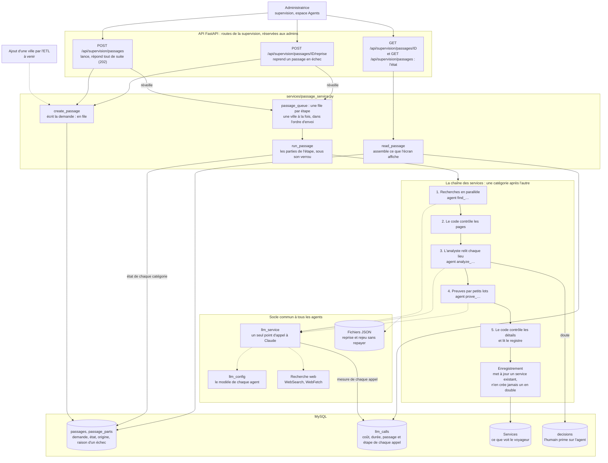

# Architecture de la chaîne des services

La chaîne des services est un agent de Randovango : pour une ville, elle cherche sur le web les
restaurants, commerces, supermarchés et laveries, avec une preuve pour chacun. L'administratrice
la lance et la suit depuis la supervision, par l'API, sans ouvrir le conteneur.

Le principe, pour tous les agents : **l'agent propose, le code contrôle, l'humain tranche.**

## Le schéma

## Ce qu'il faut retenir

- **Lancer.** `POST /api/supervision/passages` reçoit la chaîne, la ville et les catégories
  (`{"chaine": "services", "ville_id": 12, "categories": ["restaurants"]}`). La demande est écrite dans `passages`, puis
  elle entre dans la file de son étape et part à son tour : la route répond tout de suite, une grande ville pouvant
  prendre des heures.
  C'est toujours une vraie mise à jour : l'essai et le rejeu restent des outils de la ligne de commande
  (`python -m agents.find_services --essai`, `--rejouer`).
- **Un seul passage à la fois par étape.** Deux passages des services en même temps créeraient le même service deux
  fois. Un verrou tenu par MySQL l'empêche, pour l'API comme pour la ligne de commande. Un second lancement de la même
  chaîne sur la même ville est refusé (409) avec un message qui nomme le passage déjà demandé ; sur une autre ville, il
  attend son tour dans la file.
- **Suivre.** L'état vient de deux tables : `passages` et `passage_parts` disent ce qui a été demandé et où en est
  chaque catégorie ; `llm_calls` donne le coût et l'étape de chaque appel d'agent, sous le même identifiant de passage.
- **Attendre le fournisseur.** Si le quota des agents est atteint, ou s'ils reçoivent trop d'appels à la fois, la
  catégorie en cours n'échoue pas. Le service d'accès au modèle (`agents/llm_service.py`), seul à connaître le
  fournisseur, en fait une limite neutre avec son heure de retour ; le passage retourne en file, et les étapes payantes
  attendent cette heure (`services/agents_pause.py`). Elles repartent seules, sans repayer ce qui est fait.
- **Échouer et reprendre.** Une autre erreur (délai dépassé, crédit de l'API épuisé) fait passer la catégorie en
  échec avec une raison lisible, et le passage s'arrête. Les catégories finies restent enregistrées. La reprise
  (`POST /api/supervision/passages/ID/reprise`) ne refait que les catégories non finies ; une grande ville reprend en
  plus ses zones finies depuis son fichier JSON. Elle est acceptée même quand la même étape tourne sur une autre ville.
  La reprise est un nouveau passage : dans l'échec, les catégories jamais commencées passent à « reprise », avec le
  lien vers le passage qui les refait (`refaite_par`) ; une catégorie « à faire » veut donc toujours dire qu'il reste
  du travail. Les passages repris avant cette règle sont rattrapés au démarrage de la file.
- **Une chaîne en paramètre.** Les chaînes (`CHAINS` dans `passage_service.py`) se lancent toutes par les mêmes
  routes : services, spots, pépites, et les chaînes gratuites de l'ajout d'une ville (OSM, carburants, FINESS).
- **Les mesures.** `llm_calls` garde chaque appel, réussi ou non : son coût en dollars, sa durée, ses tokens,
  ses recherches web, son passage et son étape. C'est la source du suivi des coûts dans la supervision.

## La file des passages

Une ville ajoutée par l'envoi d'une rando demande ses chaînes à la file (`services/passage_queue.py`). Chaque étape
(`services/passage_steps.py`) a sa propre file et son propre fil de fond : elle prend une ville à la fois, dans l'ordre
d'envoi, et n'attend jamais les étapes qui viennent après elle.

| Étape | Elle attend, pour la ville | Payante |
|---|---|---|
| OSM et Wikidata (seul appel à Overpass) | rien | non |
| Lecture de la source des spots (un navigateur à la fois) | rien | non |
| Carburants, pharmacies FINESS | OSM et Wikidata | non |
| Pépites de la ville, services | OSM et Wikidata | oui |
| Agents des spots : harmonisation, puis ouvertures, puis vérification | la lecture de la source | oui |

- Une demande faite depuis le front avec un compte admin passe devant les envois en masse de l'ETL dans son étape :
  une demande ou une reprise depuis la supervision (origine `supervision`), une rando envoyée par un compte admin
  depuis la page d'ajout (origine `ajout`). Elle ne coupe pas le passage en cours : elle part juste après lui. Entre
  deux demandes admin, l'ordre d'envoi est gardé ; le budget et le quota s'appliquent comme aux autres. Une rando d'un
  compte contributeur, le dossier d'attente et les reprises faites seules par la file gardent l'origine `etl` et
  l'ordre d'envoi. La supervision le montre dans le champ `prioritaire` de chaque passage.
- Une ville pas prête pour une étape (son OSM pas fini, ou en échec) est sautée : l'étape prend la suivante, et
  seule cette ville attend.
- Quand le quota ou le budget des agents est atteint, seules les étapes payantes attendent ; les étapes
  gratuites continuent. Au retour, elles repartent de la ville la plus ancienne.
- Une partie gratuite en échec (OSM, carburants, FINESS, ou la lecture de la source des spots) est reprise seule un
  quart d'heure plus tard, deux fois au plus, sauf si la même chaîne est déjà en file ou en cours sur la ville, ou si
  cette partie a été refaite depuis. Un échec sur une partie payante attend toujours l'administratrice.
- Un passage resté « en cours » alors que plus rien ne le fait tourner (serveur redémarré, programme arrêté) est
  marqué « interrompu » par la file elle-même, chaque minute : sur une partie gratuite, il est ensuite repris seul, et
  les étapes de sa ville repartent. Un passage qui tourne tient un verrou MySQL à son identifiant
  (`randovango_passage_<identifiant>`) : « en cours » sans ce verrou tenu, il est coupé. Le verrou de la chaîne ne
  suffit pas à le dire, car les services, la source des spots et les agents des spots en ont un seul pour toutes les
  villes : un passage coupé paraîtrait tourner tant qu'une autre ville tient ce verrou.
- Seul le backend principal fait tourner la file. Un backend de branche (`docker-compose.branche.yml`) partage la
  base commune mais ne lance aucun thread (`PASSAGE_QUEUE_ENABLED=0`) : il ne prend pas les passages pour les faire avec
  le code de sa branche, et ne marque pas « interrompus » ceux que le principal fait tourner. Une ville ajoutée depuis
  une branche entre en file et part depuis le backend principal.

## Le coût en euros et le budget

- **En dollars dans la base.** Le fournisseur des agents facture en dollars : `llm_calls.cost_usd` garde le coût de
  chaque appel dans cette monnaie. Par l'abonnement (moteur `claude-code`), c'est ce qu'aurait coûté l'appel par l'API,
  donné par le programme `claude` : un équivalent, pas une dépense. Par l'API (moteurs `api` et `api-batch`), c'est
  une dépense réelle, calculée avec le tarif de chaque modèle (`agents/llm_prices.py`, à tenir à jour à la main).
- **En euros à l'écran.** La conversion se fait à la lecture, jamais dans `llm_calls` : dollars ÷ taux × 1,20 (TVA),
  au taux de référence de la Banque centrale européenne du jour de l'appel. C'est une estimation : la banque applique
  son propre taux et ses frais. Le taux est lu une fois par jour sur le fichier public de la BCE (90 derniers jours) et
  gardé dans `exchange_rates` (`services/exchange_rate_service.py`). Un jour sans taux (week-end, jour férié, taux du
  jour pas encore publié), le dernier taux connu sert, et le libellé le dit (« dernier connu »).
- **Ce qui s'affiche.** Le coût d'un passage et de chaque catégorie (`GET /api/supervision/passages/ID`) et les
  lignes du journal des agents donnent les dollars, les euros TTC, le taux avec sa date, et ce que vaut le coût :
  « dépense réelle » ou « équivalent API, abonnement ».
- **Le budget.** L'administratrice règle en euros TTC l'enveloppe du mois, le plafond du jour et la part gardée pour
  Vany (`GET` et `PUT /api/supervision/passages/reglage`). La dépense du jour et du mois est convertie jour par jour,
  chacun à son taux : le plafond ne bouge pas quand le dollar varie. Un passage payant ne part pas quand le budget
  est atteint (`services/budget_service.py`). Les montants sont aussi écrits en dollars dans `agent_settings`, pour le
  code qui lit encore les anciennes colonnes.
- **Le budget coupé, sur le poste de développement.** Par l'abonnement, la dépense n'est qu'un équivalent :
  `AGENT_BUDGET_ENABLED=0` coupe alors le plafond du jour et l'enveloppe du mois, et plus aucun passage n'attend à
  cause du budget. Les dépenses restent comptées et affichées, et `budget_actif` vaut `false` dans
  `GET /api/supervision/passages/reglage`. Sans ce réglage, le budget est actif (préprod, prod). Le réglage se lit
  au démarrage du conteneur de l'API : on le change avant un gros envoi, pas pendant un passage.
- **Sans aucun taux.** Si le site de la BCE n'a jamais pu être lu, la dépense ne peut pas se compter en euros : les
  passages payants attendent, un changement de montant est refusé (503), et les coûts gardent leurs seuls dollars.
