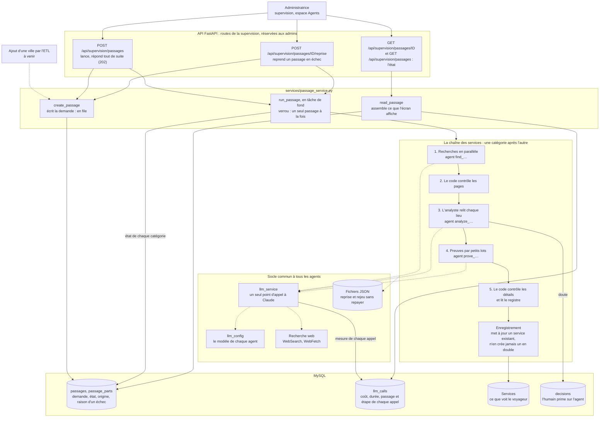

# Architecture de la chaîne des services

La chaîne des services est un agent de Randovango : pour une ville, elle cherche sur le web les
restaurants, commerces, supermarchés et laveries, avec une preuve pour chacun. L'administratrice
la lance et la suit depuis la supervision, par l'API, sans ouvrir le conteneur.

Le principe, pour tous les agents : **l'agent propose, le code contrôle, l'humain tranche.**

## Le schéma

## Ce qu'il faut retenir

- **Lancer.** `POST /api/supervision/passages` reçoit la chaîne, la ville et les catégories
  (`{"chaine": "services", "ville_id": 12, "categories": ["restaurants"]}`). La demande est écrite dans `passages`, puis
  le passage tourne en tâche de fond : la route répond tout de suite, une grande ville pouvant prendre des heures.
  C'est toujours une vraie mise à jour : l'essai et le rejeu restent des outils de la ligne de commande
  (`python -m agents.find_services --essai`, `--rejouer`).
- **Un seul passage à la fois.** Deux passages en même temps créeraient le même service deux fois. Un verrou tenu par
  MySQL l'empêche, pour l'API comme pour la ligne de commande ; un second lancement est refusé (409) avec un message
  qui nomme le passage en cours.
- **Suivre.** L'état vient de deux tables : `passages` et `passage_parts` disent ce qui a été demandé et où en est
  chaque catégorie ; `llm_calls` donne le coût et l'étape de chaque appel d'agent, sous le même identifiant de passage.
- **Échouer et reprendre.** Si Claude ne répond plus (quota atteint, délai dépassé), la catégorie en cours passe en
  échec avec une raison lisible, et le passage s'arrête. Les catégories finies restent enregistrées. La reprise
  (`POST /api/supervision/passages/ID/reprise`) ne refait que les catégories non finies ; une grande ville reprend en
  plus ses zones finies depuis son fichier JSON.
- **Une chaîne en paramètre.** Seule la chaîne des services est branchée (`CHAINS` dans `passage_service.py`) ;
  les autres chaînes (OSM, pépites, carburants) s'y ajouteront sans nouvelle route. Le lancement à la fin
  de l'ETL d'une nouvelle ville appellera les mêmes fonctions, avec l'origine `etl` et la file d'attente.
- **Les mesures.** `llm_calls` garde chaque appel, réussi ou non : son coût en dollars, sa durée, ses tokens,
  ses recherches web, son passage et son étape. C'est la source du suivi des coûts dans la supervision.

## Le coût en euros et le budget

- **En dollars dans la base.** Le fournisseur des agents facture en dollars : `llm_calls.cost_usd` garde le coût de
  chaque appel dans cette monnaie. Par l'abonnement (moteur `claude-code`), c'est ce qu'aurait coûté l'appel par l'API,
  donné par le programme `claude` : un équivalent, pas une dépense. Par l'API (moteurs `api` et `api-batch`), c'est
  une dépense réelle, calculée avec le tarif de chaque modèle (`agents/llm_prices.py`, à tenir à jour à la main).
- **En euros à l'écran.** La conversion se fait à la lecture, jamais dans `llm_calls` : dollars ÷ taux × 1,20 (TVA),
  au taux de référence de la Banque centrale européenne du jour de l'appel. C'est une estimation : la banque applique
  son propre taux et ses frais. Le taux est lu une fois par jour sur le fichier public de la BCE (90 derniers jours) et
  gardé dans `exchange_rates` (`services/exchange_rate_service.py`). Un jour sans taux (week-end, jour férié, taux du
  jour pas encore publié), le dernier taux connu sert, et le libellé le dit (« dernier connu »).
- **Ce qui s'affiche.** Le coût d'un passage et de chaque catégorie (`GET /api/supervision/passages/ID`) et les
  lignes du journal des agents donnent les dollars, les euros TTC, le taux avec sa date, et ce que vaut le coût :
  « dépense réelle » ou « équivalent API, abonnement ».
- **Le budget.** L'administratrice règle en euros TTC l'enveloppe du mois, le plafond du jour et la part gardée pour
  Vany (`GET` et `PUT /api/supervision/passages/reglage`). La dépense du jour et du mois est convertie jour par jour,
  chacun à son taux : le plafond ne bouge pas quand le dollar varie. Un passage payant ne part pas quand le budget
  est atteint (`services/budget_service.py`). Les montants sont aussi écrits en dollars dans `agent_settings`, pour le
  code qui lit encore les anciennes colonnes.
- **Le budget coupé, sur le poste de développement.** Par l'abonnement, la dépense n'est qu'un équivalent :
  `AGENT_BUDGET_ENABLED=0` coupe alors le plafond du jour et l'enveloppe du mois, et plus aucun passage n'attend à
  cause du budget. Les dépenses restent comptées et affichées, et `budget_actif` vaut `false` dans
  `GET /api/supervision/passages/reglage`. Sans ce réglage, le budget est actif (préprod, prod). Le réglage se lit
  au démarrage du conteneur de l'API : on le change avant un gros envoi, pas pendant un passage.
- **Sans aucun taux.** Si le site de la BCE n'a jamais pu être lu, la dépense ne peut pas se compter en euros : les
  passages payants attendent, un changement de montant est refusé (503), et les coûts gardent leurs seuls dollars.
